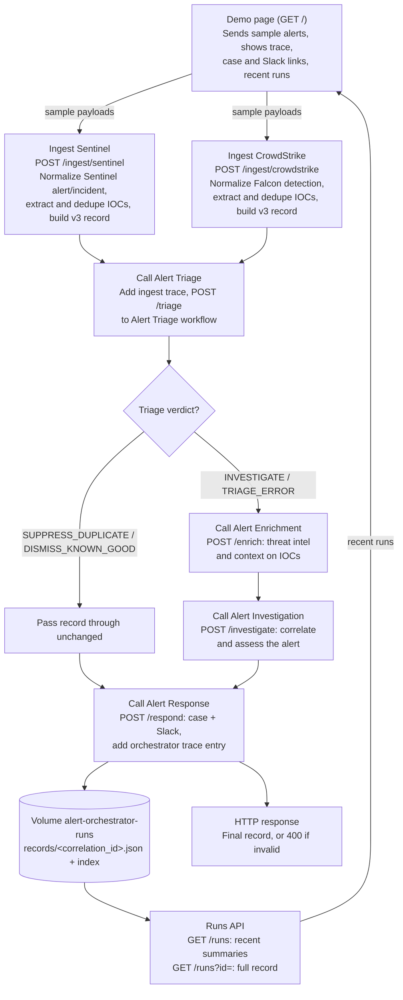

Alert Orchestrator ingests security alerts, normalizes them into the shared alert record (contract v3), and coordinates the Alert Triage, Alert Enrichment, Alert Investigation and Alert Response workflows synchronously through workflow connectors. Fully deterministic — no AI at runtime.

- `POST /ingest/sentinel`, `POST /ingest/crowdstrike` (space auth) → normalize → **Call Alert Triage** → **Call Alert Enrichment** → **Call Alert Investigation** → **Call Alert Response** → returns the final record (or 400). Each step uses only its own workflow connector; Enrichment and Investigation pass the record through untouched for SUPPRESS_DUPLICATE / DISMISS_KNOWN_GOOD.
- Final records are stored in volume `alert-orchestrator-runs`, keyed by correlation_id; `GET /runs` lists them.
- `/` is a demo page with five sample payloads.

#### End-to-end flow

Each component call has a 30 s timeout; on failure the last good record is kept and a `call_failed` trace entry is added. Invalid ingest input skips the component calls and returns 400.

`run_url` is filled from `_3B_RUN_URL` when the platform provides it, otherwise null.
